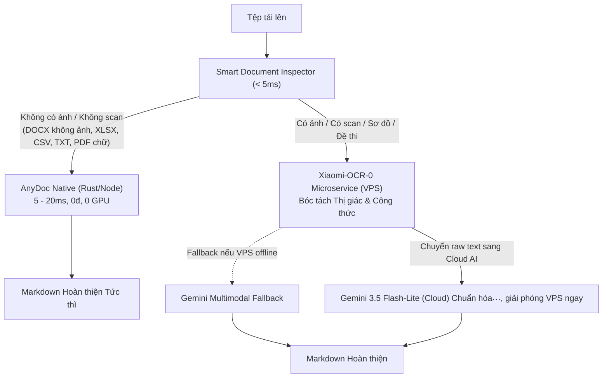

# Autonomous MarkItDown Dispatcher Design
(AnyDoc Fast-Path + VPS Xiaomi-OCR-0 Vision + Cloud Gemini 3.5 Flash-Lite)

## 1. Problem Statement & Motivation
- **Vấn đề của bộ lọc thủ công**: Bắt người dùng phải tự phán đoán chọn chế độ "Siêu tốc" hay "AI Math Polish" làm tăng ma sát trải nghiệm người dùng (UX friction), dễ dẫn đến việc chọn nhầm chế độ (ví dụ: đưa ảnh vào chế độ Siêu tốc bị lỗi, hoặc đưa file DOCX thuần text vào chế độ AI gây lãng phí token và thời gian).
- **Vấn đề tải tài nguyên trên VPS**: Nếu để mô hình AI trên VPS gánh toàn bộ quá trình từ đọc thị giác đến sinh text/format dài dòng, VPS sẽ nhanh chóng bị nghẽn CPU/VRAM khi có nhiều người dùng đồng thời.
- **Giải pháp**: Kiến trúc **Autonomous Dispatcher (Điều phối Tự động)**:
  1. Tự động kiểm tra siêu tốc (< 5ms) tệp tải lên: có chứa hình ảnh/scan hay không.
  2. **Thuần Text**: Đưa ngay cho **AnyDoc** native parser (5 - 20ms, 0đ, 0 token, 0 tải VPS).
  3. **Hỗn hợp / Ảnh / Scan**: Đưa sang **Xiaomi-OCR-0 (0.8B)** trên VPS chỉ để bóc tách thị giác (Vision Parsing), sau đó đẩy sang **Gemini 3.5 Flash-Lite** để chuẩn hóa LaTeX và định dạng Markdown, giải phóng VPS ngay lập tức.

## 2. Architecture Diagram

## 3. Detailed Component Specifications

### 3.1. Smart Document Inspector (`server/document-inspector.ts`)
- Nhận diện tệp bằng magic bytes, extension và internal structure:
  - `.docx`: Dùng `JSZip` kiểm tra sự tồn tại của `word/media/` hoặc `<w:drawing>`. Nếu không có ảnh $\rightarrow$ Pure Text.
  - `.pdf`: Kiểm tra text layer và thẻ `/Image` trong PDF. Nếu không có ảnh và có text layer $\rightarrow$ Pure Text.
  - `.xlsx`, `.xls`, `.csv`, `.txt`: 100% Pure Text.
  - Ảnh (`image/*`), PDF Scan: 100% Cần xử lý thị giác.

### 3.2. Xiaomi-OCR-0 Client (`server/gotenberg-client.ts` & `server/xiaomi-ocr-client.ts`)
- Giao tiếp với service `word2latex-xiaomi-ocr:8000` trên Docker network nội bộ của VPS.
- Trả về cấu trúc text/markdown bóc tách từ ảnh.
- Tự động bắt lỗi timeout và fallback sang Gemini Multimodal khi VPS không sẵn sàng.

### 3.3. Xiaomi-OCR-0 Microservice Scaffolding (`server/xiaomi-ocr/`)
- Cung cấp Dockerfile và service FastAPI nhẹ đóng gói model `Xiaomi-OCR-0` (0.8B).
- Endpoint: `POST /ocr/document`.

### 3.4. Cloud AI Normalizer (`api/markitdown.ts`)
- Tích hợp `gemini-3.5-flash-lite` cho tác vụ chuẩn hóa công thức toán học (`normalizeMarkdownMath`).
- Đảm bảo tốc độ sinh text cực nhanh, chi phí thấp và giải phóng VPS trong vòng < 500ms.
