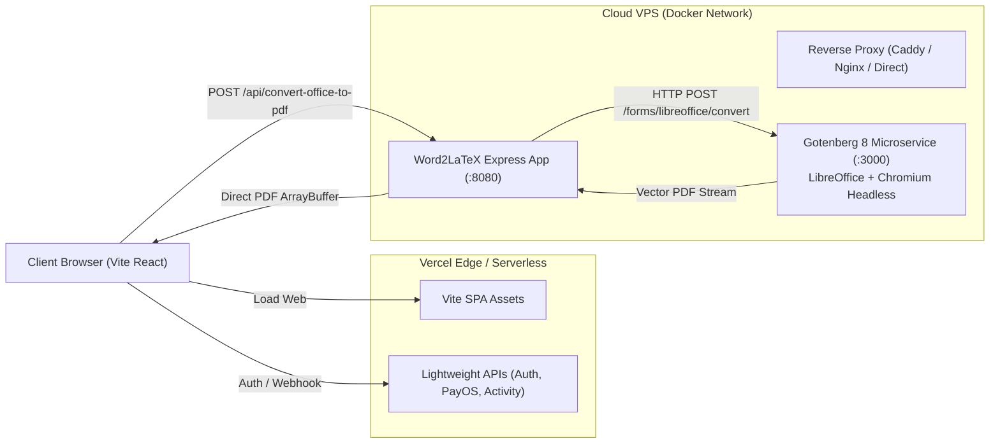

# Hybrid Gateway & Gotenberg High-Fidelity PDF Conversion Design

## 1. Problem Statement & Motivation
- **Trình biên tập PDF hiện tại**: Sử dụng thư viện `html2canvas-pro` để chụp ảnh màn hình (rasterize) từng trang DOM được sinh ra từ `mammoth.js`, sau đó chèn các ảnh PNG/JPEG này vào file PDF bằng `pdf-lib`.
  - Hậu quả: Toàn bộ văn bản bị biến thành ảnh pixel vỡ hạt khi phóng to hoặc in ấn; không thể bôi đen, sao chép hoặc tìm kiếm văn bản; tốc độ xử lý rất chậm (20-60 giây cho tài liệu dài) và dễ gây tràn RAM trình duyệt.
- **Phân luồng Vercel vs VPS Cloud**:
  - Vercel Serverless bị giới hạn cứng về thời gian thực thi (max 60s trên gói thông thường), dung lượng request body giới hạn 4.5MB, và không thể cài đặt LibreOffice hoặc Chromium native.
  - Cần kiến trúc Hybrid Gateway: Vercel phục vụ Static Assets (Vite React SPA) và Lightweight API (Auth, PayOS, User), trong khi VPS Cloud chạy Docker container độc lập chịu trách nhiệm cho Heavy Jobs (Gotenberg PDF compiler, LaTeX compiler, xử lý file lớn).

## 2. Architecture Overview

## 3. Key Components
1. **Gotenberg Docker Container (`gotenberg/gotenberg:8`)**:
   - Đóng gói sẵn LibreOffice 24.x headless và Chromium headless cùng bộ font đa ngôn ngữ (Noto Sans, Liberation Fonts).
   - Tự động chuyển đổi `.docx`, `.pptx`, `.xlsx`, `.rtf`, `.odt` thành PDF vector native 100% chuẩn in ấn (Selectable text, high-DPI images, chuẩn ISO PDF).
2. **Backend Dispatcher (`api/convert-office-to-pdf.ts` & `index.ts`)**:
   - Nhận file từ multipart hoặc base64.
   - Kiểm tra xác thực token (Firebase Auth) và quota.
   - Stream file sang `http://gotenberg:3000/forms/libreoffice/convert`.
   - Trả trực tiếp `application/pdf` về client mà không ghi đĩa tạm nhằm tối đa hóa tốc độ.
3. **Frontend Integration (`src/utils/office-to-pdf.ts`)**:
   - Loại bỏ hoàn toàn quy trình DOM render + `html2canvas-pro` chụp ảnh.
   - Gọi trực tiếp API VPS `/api/convert-office-to-pdf`.
   - Giữ fallback client nhẹ bằng `pdf-lib` (extract text) nếu mạng lỗi.
4. **Docker Compose Stack (`docker-compose.yml`)**:
   - Quản lý đồng thời service `app` và service `gotenberg` trên mạng nội bộ `app-net`.
